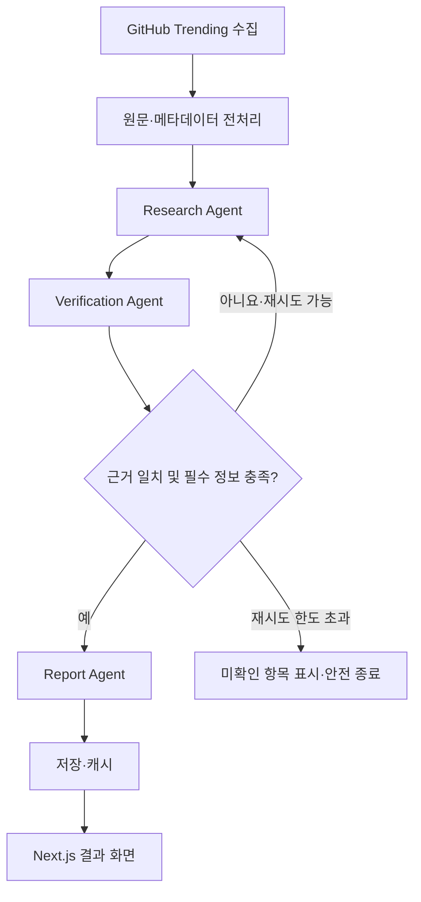

# 김은혜 | 이력서·포트폴리오 콘텐츠 설계 및 구현 계획 (기존 PDF 보존·신규 내용 보완)

> 버전: 0.3 (QUOKIT AI Agent **가정 완료 시나리오** 추가) · 2026-10-21
> 목적: PDF를 재열람하지 않아도 이후 AI 에이전트가 이력서와 포트폴리오를 **서로 다른 결과물**로 작성하도록 지원하는 Markdown 기반 작업 원본.
> 이 파일은 **완성된 이력서가 아니라 자료 정리 및 구현 계획**이다. **기존 두 PDF의 중복 내용을 합치거나 삭제하지 않고 유지하며** 신규 프로젝트/경험을 추가 보완한다. 항목별 근거와 검증 상태를 읽고 확인되지 않은 내용을 확정해 쓰지 않는다.
> 이 파일은 우선 확인된 내용으로 갱신한 **작업본**이다. 마지막의 확인 질문에 답을 받으면 완성본으로 업데이트한다.

## 0. 사용 지침 — AI 에이전트가 가장 먼저 읽을 것

1. 이 문서를 읽고 즉시 HTML을 생성하지 말 것. **사실 확인 → 프로젝트 선정 → 이력서 문구 → 포트폴리오 상세 원고 → 디자인 → 구현** 순서로 진행할 것.
2. `[PDF 확인]`은 **첨부 PDF에 그렇게 적혀 있다는 뜻**이지, 코드·실제 서비스로 독립 검증되었다는 뜻이 아니다.
3. `[사용자 초안]`은 이번 대화에서 제출한 새 뼈대의 주장이다. PDF와 불일치하거나 PDF에 없을 수 있다.
4. `[추가 확인]`은 코드, GitHub, 실행 화면, 사용자 답변, 테스트 로그 등이 없어서 확정하면 안 되는 내용이다.
5. `[제안]`은 향후 문서 구성 권고이며 실제 수행했다는 주장이 아니다.
6. **개발하지 않은 기능, 측정하지 않은 수치, 수행하지 않은 기술적 비교를 절대 창작하지 말 것.** 특히 AI Agent, Redis, RAG, 성능 최적화 및 평가 점수에 주의한다.
7. 한 프로젝트의 팀 전체 기능과 본인이 직접 구현한 기능을 구분한다. '기여도 100%' 등은 검증 후에만 기재한다.
8. 자료 간 모순은 덮어쓰지 말고 `검증 대기`로 남기고 사용자에게 확인한다.
9. 개인정보(휴대전화, 이메일)는 공개 웹 포트폴리오에 그대로 노출하기 전에 사용자의 승인을 받는다.
10. 이력서와 포트폴리오는 동일한 **사실 원본**을 공유하되, 표현과 상세도는 별도로 작성한다.
11. **기존 PDF의 항목, 순서, 설명, 중복 표현은 기록 단계에서 유지**한다. 새로운 작업으로 기존 이력·프로젝트 원문을 재작성하거나 통합하지 않는다. 최종 제출용 편집은 별도로 승인을 받는다.
12. **지원 방향 / 희망 포지션을 별도의 프로필 행으로 만들지 않는다.** 특정 채용공고 맞춤형 표제는 향후 요청 시만 작성한다.
13. 현행 GitHub 레포에서 확인되는 구현과 과거 초안의 주장이나 예정 기능을 명확히 구분한다. README 설명은 프로젝트 작성자의 설명이며 전체 코드 실행 검증을 뜻하지 않는다.
14. SeSAC 교육은 **2026.06~2026.10 수료**로 기록한다.
15. 이 문서와 결과물에서 과장된 홍보 문구와 AI 직역체를 피한다. 실제 원문 복구와 첨삭을 혼동하지 않는다.
16. **QUOKIT AI Agent 목표 확장 기능은 사용자가 '이력서 제출 전 완료되었다고 가정한 설계안'으로 작성해 달라고 요청한 항목이다.** `[가정 완료 시나리오]`로 표시하되, 확인된 현재 기능에 합쳐 이미 구현했다고 단정하지 않는다. 이력서·포트폴리오 외부 제출 전에는 코드, 커밋, 실행 및 테스트 증거를 확보해 `구현 확인`으로 전환한다.
17. 가정 시나리오를 토대로 예시 문장을 작성할 경우에도 이력서에 바로 붙여 넣을 확정 문구가 아니라 **구현 완료 후 사용할 후보 문장**임을 명시한다.

## 1. 자료 출처 및 우선순위

- **[PDF A]** `김은혜_새싹서초캠퍼스_포트폴리오.pdf` (7쪽): 7개 프로젝트의 기능, 시스템 흐름, 문제/해결, 학습 내용 및 이미지.
- **[PDF B]** `김은혜_새싹서초캠퍼스_입사지원서(1).pdf` (10쪽): 기본 경력·학력·연락처, 프로젝트별 역할, GitHub URL 및 자기소개서.
- **[사용자 초안]** 대화에 제공한 `Resume Skeleton`과 `Portfolio Skeleton`: QUOKIT, 완성된 조직 적합도 및 조기 퇴사 위험 분석 Agent 등 신규 프로젝트, 목표 직무 및 희망 구조.
- **향후 추가할 근거**: 각 프로젝트 GitHub README·코드·커밋, 기술 설계 문서, 테스트 결과, 배포 URL, 캡처/시연 영상, 교육 수료증.

### 근거 우선순위

최신 사용자 직접 확인 > 코드·테스트·배포 근거 > 첨부 PDF의 구체적인 프로젝트 기술 > 기존 이력서의 자기소개성 주장 > 새로 제시한 예시/초안. 근거가 충돌하면 자동 통합하지 말고 확인 요청.

## 2. 현재 확인 가능한 기본 프로필

| 항목 | 내용 | 상태/출처 |
|---|---|---|
| 이름 | 김은혜 | [PDF B] |
| GitHub | https://github.com/eeeunhey | [PDF B] |
| 이메일 | PDF B에 기재되어 있음; 제출 전 최신 주소와 공개 범위 확인 | [PDF B] [추가 확인] |
| 전화 | PDF B에 기재되어 있음; 공개용에는 기본 비노출 권장 | [PDF B] [추가 확인] |
| 고려사이버대학교 | AI 데이터과학부, 2026.03~ 편입 재학 기재 | [PDF B] |
| 한국방송통신대학교 | 식품영양학과 졸업, 2016.02~2021.02 기재 | [PDF B] |
| 폴리텍 하이테크 | 성남 폴리텍, 2024.01~12, Java/Spring/Boot/MyBatis/JPA·Python 기재 | [PDF B] |
| KDT 국비 과정 | 2023.03~09, C/Java/Python 기초 | [PDF B] |
| SeSAC 서초캠퍼스 | 2026.06~2026.10 **수료** | [사용자 직접 확인] 정식 과정 명칭은 수료증 기준으로 추후 확인 |
| 머신비전 솔루션팀 | 2024.02~2024.11, 비전 세팅·카메라 파라미터 조정 지원, C# WinForms 일부 UI 수정·테스트, 개선사항 보고 | [PDF B] |
| 쿠팡 물류 전산·관리 | 2019.03~2021.11, 단기 인력 배치·스케줄 조율, 출고 전산 흐름 점검·마감관리 | [PDF B] |
| 자격증 | 컴퓨터활용능력 1·2급, ITQ A등급, GTQ 1·2급, 운전면허 1종 보통 | [PDF B] 기재; 제출 시 유효성과 중복 표기 확인 |

**경력 주의:** 새 뼈대에는 WMS 정합성 검증, 일평균 N만 건 처리, 이미지 라벨링, 버그 수정 주기 단축 등이 있다. 이 세부 업무와 수치는 PDF B의 명시적 업무 내역을 넘어가므로 근거 확인 전에는 본문에 넣지 않는다. 회사의 정식 명칭, 퇴사 월(2024.11 vs 다른 이력 기록), 직책도 다시 확정한다.

## 3. 프로젝트 원본 목록 — PDF 기반

프로젝트별로 **PDF에 작성된 설명**을 기록한다. 개인 구현 범위 및 코드 재현성은 별도 검증한다.

### P01. Daily Emotion Log

- **시기/규모**: 2025.12 / 5인 팀 / PM·Full-stack [PDF A/B]
- **스택**: HTML/CSS/JavaScript, Flask, MariaDB, Gemini API, Cloudtype [PDF A/B]
- **목적**: 8종 감정 선택과 메모 입력, AI 피드백 및 감정 변화 시각화.
- **PDF상 기능**: 감정 선택 UI, Gemini 감정별 프롬프트, 주간·월간 리포트, 차트, API 오류/로딩 처리.
- **개인 역할로 기재된 내용**: PM 요구사항·일정 관리, Flask API 설계·구현, Gemini 연동, Cloudtype 배포 설정 [PDF B].
- **트러블슈팅 후보**: 선택 상태가 불명확한 버튼 UI, AI 응답 대기 UI, fetch 실패 시 예외 처리 [PDF A].
- **GitHub**: https://github.com/eeeunhey/daily-emotion-log [PDF B]
- **추가 확인**: DB 인덱스와 차트 속도 개선의 실제 코드/측정, 본인 담당 컴포넌트, 배포 가능 상태.

### P02. BalanceEat

- **시기/규모**: 2025.10~11 / 4인 팀 / PO·Frontend [PDF A/B]
- **스택**: React, TypeScript, Nutrition API, Gemini API, Local Storage, Figma.
- **목적**: 음식 영양 정보 조회, 영양소 달성률 시각화, 부족 영양소 기반 식단 추천.
- **PDF상 기능**: Nutrition API 검색, 3일 기록 기반 AI 추천, 도넛 차트, 날짜별 기록.
- **개인 역할 근거**: PO로서 요구사항과 와이어프레임, 프론트엔드 담당 [PDF A/B].
- **트러블슈팅 후보**: 응답 필드 누락값 정규화, 타입 정의, 렌더링 최적화 [PDF A].
- **GitHub**: https://github.com/eeeunhey/balanceeat [PDF B]
- **추가 확인**: React.memo/useMemo 적용 전후 실측, 외부 API의 정확한 스키마, 팀원별 담당 영역.

### P03. Ascend — AI 이력서 코치

- **시기/규모**: 2025.10~12 / 개인 [PDF A/B]
- **스택**: React, TypeScript, Vite, Tailwind CSS, Zustand, React Query, Puter.js.
- **목적**: PDF 이력서 업로드 후 섹션별 AI 평가, 문구 수정 제안, 키워드 시각화.
- **PDF상 기능**: 섹션 분리, AI 채점, ATS 키워드 맵, 상태 분리, 응답 캐싱.
- **트러블슈팅 후보**: props drilling, UI 상태와 비동기 데이터 분리, 반복 호출 [PDF A/B].
- **GitHub**: https://github.com/eeeunhey/Ascend [PDF B]
- **추가 확인**: '버그 탐색 시간 50% 감소' 측정 근거, ATS 점수의 실제 평가 기준, React Query 캐시 키 설계.

### P04. ResumeBuilder — 이력서 빌더

- **시기/규모**: 2025.10~11 / 개인 [PDF A/B]
- **스택**: React, TypeScript, Vite, 상태 관리.
- **목적**: 섹션별 입력, 동적 항목 관리, 실시간 미리보기.
- **PDF상 기능**: 작성 폼, 가이드, 섹션 추가·삭제, 미리보기, 입력 상태 유지.
- **트러블슈팅 후보**: 리렌더링, React.memo/useMemo, 동적 key 충돌과 입력 유실 [PDF A].
- **GitHub**: https://github.com/eeeunhey/ResumeBuilder [PDF B]
- **추가 확인**: 상태 지속 방식, uuid 사용, 성능 측정 여부.

### P05. Interview Simulator

- **시기/규모**: 2025.09~11 / 팀 프로젝트 / 프론트엔드 담당 [PDF A/B]
- **스택**: React, TypeScript, WebRTC, Recharts, Node.js, Express, MongoDB.
- **목적**: 면접 질문·답변·표정 데이터를 수집하고 시간축에 동기화한 모의 면접 서비스.
- **PDF B에 명시된 개인 역할**: 질문 생성 UI/흐름 구현, Recharts 시각화 컴포넌트, WebRTC 연동, 세션 리포트 페이지.
- **PDF상 팀 기능**: AI 질문 생성, STT, 표정·집중도 분석, 타임라인, 세션 리포트.
- **트러블슈팅 후보**: 음성과 표정 데이터의 생성 시점 불일치, 타임스탬프 정렬, 권한 거부 시 오류 UI [PDF A].
- **GitHub**: https://github.com/eeeunhey/MockInterview [PDF B]
- **추가 확인**: 얼굴 분석과 STT의 실제 구현 주체, 동기화 알고리즘/테스트 로그, 팀 규모.

### P06. Velin — AI Interview Prep

- **시기/규모**: 2025.08~09 / 개인 [PDF A/B]
- **스택**: PDF A에는 React, TypeScript, Node.js, Vercel. PDF B에는 Vite, Tailwind, Node/Express, Recharts, TanStack Query, FFmpeg(WASM), MongoDB 등 추가 기재. **버전/적용범위 확인 필요**.
- **목적**: 직무·경력에 맞는 AI 면접 질문, 답변 근거, 체크리스트 생성.
- **PDF상 기능**: 동적 프롬프트 구성, 질문/답변 방향, 체크리스트, 재시도/로딩 처리.
- **GitHub**: https://github.com/eeeunhey/AI_InterviewPrep [PDF B]
- **추가 확인**: 실제 배포 URL, 세션 저장, JWT/파일 업로드, 멀티모달 분석이 동일 버전에 포함되는지.

### P07. ALBAIT — 콘솔 구인·구직

- **시기/규모**: 2025.04~05 / 개인 [PDF A/B]
- **스택**: Java, Oracle DB, JDBC, DAO/DTO 또는 DAO/VO.
- **목적**: 회원·공고·지원 CRUD, 관계형 DB 처리, 계층 분리.
- **PDF상 기능**: 공고와 지원 상태 관리, 통계 쿼리, PreparedStatement, DB 제약조건.
- **트러블슈팅 후보**: SQL/도메인 로직 혼재로 인한 유지보수 문제, DAO 계층 분리.
- **GitHub**: https://github.com/eeeunhey/AlbaItProject [PDF B]
- **추가 확인**: DAO/DTO/VO 실제 명칭, 인덱스/실행계획 분석 수준, 쿼리 최적화 지표.

## 4. 신규 프로젝트 추가 — 기존 PDF에 없었던 2개 프로젝트

**원칙:** 신규 프로젝트는 PDF A/B에 나오지 않는 **추가 경험**이다. 이를 넣는다는 이유로 기존 P01~P07을 삭제·합치지 않는다. 최종 이력서에는 대표 2~3개만 선택하더라도, 마스터 원본에서는 **전체 9개 프로젝트를 보존**한다.

### N01. QUOKIT — GitHub Trending 한국어 큐레이션 및 AI 리서치 플랫폼

- **GitHub (확인)**: https://github.com/eeeunhey/quokit-platform
- **웹 서비스 (레포에 안내됨)**: https://quokit-kr.vercel.app/
- **기간·형태**: 초기 초안에는 `2026.01~진행 중 / 개인`으로 기록. 정확한 시작 시점·기여 범위는 추후 확인.
- **자료 구분**: 현재 공개 프로젝트의 내용과 **'LangChain·LangGraph 에이전트까지 구현을 마쳤다고 가정한 목표 버전'**을 별도 단락으로 보존한다.

#### N01-A. 공개 자료에서 확인한 기존 구현 설명 (2026-10-21 조사 기록 보존)

- **목적**: GitHub Trending 저장소를 수집하고 한국어로 README·오픈소스 정보를 제공하는 서비스.
- **레포에 기재된 스택**: Next.js 16, React 19, TypeScript, Tailwind CSS, Recharts, Next.js API Routes, Prisma, Supabase(PostgreSQL), Upstash Redis, Vercel Cron, GitHub API, Cheerio, HuggingFace OPUS-MT, Bing/Google 번역 API.
- **레포의 구현 설명**:
  - Cheerio 기반 GitHub Trending 수집 및 메타데이터 파싱.
  - HuggingFace OPUS-MT 및 Bing/Google 번역 API를 활용하는 번역 fallback.
  - Redis → 데이터베이스 → 외부 API 조회/캐시 계층.
  - Vercel Cron 기반 트렌딩 갱신, 번역 및 캐시 정리.
  - 토픽 교집합 기반 연관 레포지토리 추천, 관리자 접근 보호.
- **증거 범위**: 이전 작업에서 README 및 package.json을 참고한 기록. 서비스 실행, 모든 코드 경로 및 기여도를 독립적으로 테스트한 것과 동일하지 않음.

#### N01-B. [가정 완료 시나리오] LangChain·LangGraph 멀티 에이전트 확장

> **중요**: 이 절은 사용자의 요청에 따라 **구현을 모두 끝낸 미래 상태를 가정해 설계한 포트폴리오 기획안**이다. 현재 완료된 기능이라는 확인 결과가 아니다. 외부 제출용 이력서에서 완료 사실로 표기하기 전에 아래 체크리스트로 검증한다.

- **목표**: 트렌딩 레포 수집에서 끝나지 않고 README·코드·메타데이터를 분석하여, 근거를 확인한 한국어 기술 리서치 리포트를 생산한다.
- **가정한 역할 분담**:
  1. `Research Agent` — GitHub 메타데이터와 README, 필요한 코드 파일을 탐색하여 기술 스택·구조·사용법의 근거를 수집한다.
  2. `Verification Agent` — 수집한 원문과 생성된 설명이 일치하는지 항목별로 점검하고 누락된 근거가 있으면 재탐색을 요청한다.
  3. `Report Agent` — 검증된 사실을 사용해 한국어 리서치 요약을 생성하고 구조화된 결과를 반환한다.
- **오케스트레이션 설계**: Python + LangChain Tool + LangGraph StateGraph로 실행 상태를 공유하며, 검증 결과에 따라 재탐색하거나 리포트 생성으로 분기한다.
- **예시 State 필드**: `repo_id`, `repo_metadata`, `readme_text`, `retrieved_sources`, `analysis_draft`, `verification_issues`, `retry_count`, `final_report`, `errors`.
- **가정한 워크플로**:



- **설계상 추가 선택지(실제 적용 여부는 미확정)**:
  - `pgvector` RAG: 과거 리포트 검색이 실제 필요하고 테스트에서 효용을 입증하는 경우 적용.
  - Redis 캐시: 원문 수집 캐시와 LLM 분석 결과 캐시를 분리하고, 키·TTL·버전 변경 정책을 문서화.
  - Structured Output: Pydantic 등의 스키마로 분석 결과의 데이터 구조 검증.
  - Python Agent와 Next.js 연계: 별도 Python API/작업 큐 또는 다른 실행 방식 가운데 실제 구성에 맞는 방식을 선택.
- **중요한 기술적 주의**:
  - LLM이 임의로 부여한 `confidence > 0.8`만으로 환각 여부나 사실 정확도를 입증할 수 없다. 출처·인용 일치성, 결측 필드, 테스트 케이스 중심으로 평가 규칙을 만든다.
  - Redis 캐시 사용만으로 '비용 0원', `RAG` 도입만으로 '정확도 향상'이라고 단정하지 않는다.
  - AST 전처리, SHA-256 키, Reranker 등은 **구현 증거가 생기기 전까지** 자동으로 완료 항목에 추가하지 않는다.

#### N01-C. 구현 완료 후 사용할 이력서 **후보 문구** (현재 사실 확정 아님)

> 아래 문장들은 **해당 코드를 실제로 작성·테스트한 뒤** 사용할 수 있는 가정 완료형 예시다. 그대로 외부 제출하지 않는다.

- `LangGraph StateGraph를 이용해 기술 조사, 근거 검증, 한국어 리포트 생성 노드를 연결하고 검증 실패 시 재탐색 분기를 구현함.`
- `LangChain 기반 GitHub 자료 검색 Tool을 구성하고 에이전트 단계별 입력·출력 구조를 정의함.`
- `분석 결과의 근거 누락·파싱 오류를 식별하도록 구조화된 출력 검증과 실패 처리 흐름을 구성함.`
- `Next.js 기반 기존 트렌딩 서비스와 AI 분석 결과 저장·조회 흐름을 연동함.`

**포트폴리오 심층 설명에 필요한 증거**: StateGraph 정의 코드, 각 Node와 Tool 구현, 조건 분기 테스트, LLM 모델/프롬프트/출처 추적, 실제 생성 리포트, 연동 API, 실패 케이스, 토큰·지연시간·캐시 비교 로그.

#### N01-D. 외부 제출 전 검증 체크리스트

- [ ] Python과 LangChain/LangGraph 코드가 저장소 또는 검증 가능한 별도 서비스에 존재함.
- [ ] StateGraph, Node, 조건부 Edge와 Tool 실행이 재현됨.
- [ ] 실제 GitHub 자료를 사용해 리서치 결과를 생성한 시연 기록이 있음.
- [ ] 사실 검증/재검색/오류 처리 시나리오를 테스트함.
- [ ] 결과가 QUOKIT 웹 화면 또는 저장소에 정상적으로 연결됨.
- [ ] 포트폴리오 다이어그램이 실제 코드 경로와 일치함.
- [ ] 성능·비용·정확도는 측정 자료가 있는 항목만 기재함.
- [ ] 개인 구현·기여 범위를 코드/커밋으로 설명할 수 있음.

### N02. 조직 적합도 및 조기 퇴사 위험 분석 AI Agent

- **프로젝트명 (사용자 지정)**: `조직 적합도 및 조기 퇴사 위험 분석 AI Agent`
- **완료 상태**: **완성** `[사용자 직접 확인 · 2026-10-21]`
- **기존 PDF 관계**: PDF A/B에는 없는 **신규 추가 프로젝트**. 기존 내용을 대체하지 않음.
- **배경과 목적 (사용자가 제공한 초안)**: 기업 조직문화·핵심가치와 지원자 자료를 비교하여 적합도 및 조기 퇴사 위험 요소를 분석하는 AI 에이전트.
- **기존 대화에서 소개된 개발 맥락**: 2인 팀, 사용자 담당 `지원자 파트`, 기업/지원자 비교 지표, 검색 도구(`search_company_documents`, `search_company_web`), 근거와 검증의 필요성을 강조. **최종 실제 구현 범위는 발표/저장소 확인 필요**.
- **아직 최종 코드·발표 자료로 확인되지 않은 초안 기능**: FastAPI, 특정 Vector DB, semantic chunking, BM25+Dense Hybrid Search, Reranker, 매칭 정확도 개선율, API 서빙 등. **완성 여부와 해당 기능 구현 여부는 별개의 문제**임.
- **정량 예측 표현 유의**: 조기 퇴사 위험 점수가 곧 실제 미래 퇴사율 또는 검증된 예측 정확도라는 뜻은 아님. 실제 데이터·평가 근거가 없으면 `위험 요소 분석` 또는 `위험도 지표 산출`처럼 구현과 일치하는 표현을 사용.
- **추가 자료 필요**: 프로젝트 GitHub URL/압축 파일, 진행 기간, 팀원·역할, 발표/시연 자료, 최종 아키텍처, 본인 구현 코드, 실제 기술 스택, 평가 기준, 문제 해결 사례.
- **권장 배치**: 대표 프로젝트 후보로 유지. 완성 프로젝트로 표기하되 기술 스택과 구현 설명은 검증 결과에 따라 작성.

## 5. 원본 간 충돌·과장 위험 검증표

| 초안 주장 또는 충돌 | 기존 PDF와 관계 | 필요한 확인 |
|---|---|---|
| QUOKIT 공개 구현과 AI Agent 목표 확장 | 공개 레포 기반 내용과 사용자 요청의 **구현 완료 가정 시나리오**는 구분 | 코드를 작성·시연한 후 이력서 후보 문구를 최종 확정 |
| 조직 적합도 프로젝트 완료 상태와 개별 구현 기능 | 사용자 직접 확인으로 프로젝트 **완성**. 구체 기능은 별도 확인 | GitHub·발표자료·개인 구현 범위 확인 |
| 'AI 에이전트와 백엔드 시스템의 신뢰성을 설계' | 역량 수준을 강하게 암시하는 헤드라인 | 구체적 코드/테스트 사례 없으면 간결하게 축소 |
| 'RAG 검색 정밀도 향상, 상태 기반 예외 복구, 토큰 비용 최적화' | PDF상 확인되지 않는 성과 | 실제 평가·측정 로그 없으면 Introduce에서 삭제 |
| 머신비전 이미지 라벨링/버그 수정 주기 단축 | PDF B에는 비전 셋팅, WinForms 수정·테스트 중심 | 담당 업무 및 성과 확인 |
| 쿠팡 WMS 정합성 및 N만 건 데이터 처리 | PDF B에는 스케줄, 출고 흐름 점검·마감 | 실제 업무 범위와 단위 확인 |
| 2024.11 vs 2024.12 퇴사 | 이 문서 PDF B는 2024.11 | 정확한 근로 계약/경력증명 확인 |
| '재학 3학년' | PDF B에는 편입 재학만 표기 | 학년 확인 |
| 새싹 교육 수료 상태 | 사용자 직접 확인으로 **2026.06~2026.10 수료** | 정식 과정 명칭은 수료증과 대조 |
| Velin 기술스택/구현 범위 | PDF A/B 간 기재 폭 다름 | 해당 시점 코드/버전 확인 |
| PDF상 정량 개선율, 오류 감소 | 소개 텍스트 자체 주장 | 실측 자료 없으면 정성 서술로 변경 |
| 자격증 중 정보처리기사/SQLD 등 | 제출 초안에 확인 필요로 기재 | 취득 여부 확인 전 포함 금지 |

## 6. 결과물 A — 이력서 설계

**원칙:** Wonny 구조를 참고하지만, 초·주니어 전환형 경험에 맞게 1~2페이지 우선. 성과를 억지로 늘리지 않는다.

### A-1. 확정 전 목차

1. **Contact** — 이름, 이메일, GitHub, 포트폴리오. 사용자가 삭제 요청한 **지원 방향/희망 포지션 행은 만들지 않는다**.
2. **Introduce** — 사실 검증 후 2~3문장 요약. 프로젝트/기술 정리 **이후** 작성.
3. **Selected Projects** — 대표 2~3개. 검증된 구현·역할 중심, 개당 3~5개 핵심 항목.
4. **Technical Skills** — 직접 구현 / 실습·학습으로 구분. 기술에 대한 주관적 '전문가' 등급 금지.
5. **Work Experience** — 쿠팡 및 머신비전 경력을 정확한 업무 중심으로 요약.
6. **Education** — SeSAC(2026.06~2026.10 수료), 폴리텍, KDT, 고려사이버대, 방송통신대(표기 우선순위는 지원 직무별 변경).
7. **Certificates & Activities** — 증빙 가능하고 직무 관련성이 높은 항목만.

### A-2. 내용 작성 순서

`프로젝트 사실 정리 → 대표 프로젝트 확정 → 역할/기술 검증 → 경력·학력 기간 확인 → 스킬 정리 → Introduce 작성 → 1~2페이지 압축`

### A-3. 프로젝트 1개 표준 양식

```md
### [프로젝트명] | [기간] | [개인/팀·역할]
[프로젝트를 만든 이유와 목표를 한 문장으로]
기술: [실제 코드에서 확인된 기술]
- [내가 구현한 기능 + 사용한 기술]
- [문제 상황 + 해결 조치]
- [실제 확인 가능한 결과; 없으면 생략]
GitHub: [URL] · Demo: [URL 또는 없음]
```

### A-4. 권장 후보 (최종 순서는 검증 후 결정)

- QUOKIT: **공개 레포와 서비스 주소 확인**. 현재 설명은 N01-A에서 인용하고, **구현 완료를 가정한 LangChain/LangGraph 확장안은 N01-B~D**에서 관리. 실제 개발·시연 후 후보 문구 채택.
- 조직 적합도 및 조기 퇴사 위험 분석 AI Agent: **완성 프로젝트**. 최종 코드·개인 역할·평가 근거 확인 후 상세 소개.
- Ascend 또는 Daily Emotion Log: **PDF에 비교적 구체적 근거가 있는 대안**.
- AI 직무 적합성과 본인 구현 근거를 모두 만족하는 2~3개만 채택.

## 7. 결과물 B — 기술 포트폴리오 설계

**원칙:** 이력서 설명 복제 금지. 실제 코드와 기술적 의사결정을 읽고 면접관이 질문할 수 있는 구조.

### B-1. 페이지 구조

- `Home`: 1~2문장 소개, 대표 프로젝트, GitHub, 이력서 PDF 연결.
- `Projects`: 프로젝트 목록, 역할/기간/기술, 심층 분석 여부.
- `Project Detail`: 대표 프로젝트 2~3개만 깊게 분석.
- `Notes` (선택): 실제 작성한 기술 노트/테스트·실험 기록.
- `Experience`: 경력·교육·관련 활동의 간결한 요약.
- `Contact`: 제출용 연락 채널.

`Tech Ecosystem` 별도 페이지는 필수 아님. 기술 목록을 한눈에 보여주는 페이지보다 각 프로젝트에서 기술이 실제로 어떤 역할을 했는지 설명할 것.

### B-2. Project Detail — 상세 콘텐츠 템플릿

```md
# [프로젝트 제목]

> 한 줄 설명 | 기간 | 팀 구성 | 내가 담당한 역할 | GitHub | Demo

## 1. 배경과 문제
- 실제 어떤 불편/요구에서 시작했는가?
- 대상 사용자는 누구인가?

## 2. 목표와 제약
- 핵심 요구사항과 제외한 범위는 무엇인가?
- 기간·인원·기술적 제약은 무엇인가?

## 3. 전체 동작 흐름
- 입력 → 처리 → 저장 → 출력의 흐름
- Mermaid 또는 아키텍처 이미지 (코드와 일치할 것)

## 4. 나의 구현 범위
- 직접 수정한 폴더·파일·함수·노드
- 팀원 구현/외부 API와 경계

## 5. 핵심 기술적 판단
- 선택지와 선택 이유 (실제 비교한 경우에만)
- 적용한 코드의 짧은 핵심 부분

## 6. 문제 해결
- 증상 / 재현 방법 / 원인 / 수정 / 수정 후 확인
- 로그·스크린샷·테스트로 연결

## 7. 결과와 검증
- 무엇을 어떤 환경에서 테스트했는가?
- 수치가 없다면 확인 가능한 동작 결과를 정확히 기술

## 8. 한계와 다음 단계
- 현재 미구현 / 이후 개선 제안 구분

## 9. 관련 자료
- Repository / README / 커밋 / 데모 / 문서
```

### B-3. AI Agent 프로젝트 추가 항목 (구현한 경우만)

- LangGraph: State schema, node, edge, conditional routing, failure/retry 분기.
- RAG: 원본 데이터, chunking, embedding, index, retrieval, 평가용 질의와 근거.
- Agent 검증: 환각·근거 일치성 판정 방식, 성공/실패 케이스, 재시도 조건.
- 비용/성능: 모델명, 요청 횟수, 토큰, 캐시 적중, 처리시간, 비교 조건.
- 보안: 환경 변수, 키 노출 방지, 데이터 보관 방식.
- 실행: 시작 명령어, Docker 또는 배포 프로세스, 최소 재현 예제.

## 8. AI 생성 문체·디자인 억제 원칙 및 참고 레포 Skill

### 문장
- 실제 한국 개발자의 이력서 문체로 작성. 이력서는 개조식, 포트폴리오 본문은 자연스러운 설명식도 허용.
- 피할 표현: '혁신적인 솔루션', '가치 창출', '최첨단', '경험 극대화', '견고한 시스템' (근거 없는 경우).
- 원칙: **구현 사실 → 기술 선택의 맥락 → 검증 가능한 결과**.
- 모든 항목을 PSAC 틀에 억지로 맞추지 말 것. 실험이 없는 경우 '검증된 수치' 섹션을 만들어내지 않는다.

### HTML/CSS — 공개 스킬과 가이드의 **원문을 읽고** 작업할 것

1. **Anthropic `frontend-design` 공식 Skill**: https://github.com/anthropics/skills/blob/main/skills/frontend-design/SKILL.md
   - HTML/React 작성 전 디자인 방향, 콘텐츠 위계, 타이포그래피와 레이아웃의 이유를 먼저 제안.
   - 개성 있는 시각적 판단을 요구하되 우선순위는 사용자의 이력서·프로젝트 정보 전달에 둠.
2. **Vercel `web-interface-guidelines` 공식 저장소**: https://github.com/vercel-labs/web-interface-guidelines
   - 시맨틱 HTML, 포커스·키보드 접근성, 화면 크기, 링크, 인터랙션 동작 검토.
3. **`avoid-ai-design` 커뮤니티 스킬**: https://github.com/funboy322/avoid-ai-design
   - AI가 흔히 생성하는 과도한 그라데이션, 반복되는 둥근 카드, 형식적인 히어로 등을 점검. 커뮤니티 프로젝트이므로 사용 전 내용을 검토하고 맞지 않는 규칙은 채택하지 않음.
4. **Toss `technical-writing`**: https://github.com/toss/technical-writing
   - 한국어 기술 문장과 포트폴리오 서술의 명확성 검토에 활용.

**실행 지침**
- 레포 이름만 언급하는 것으로 끝내지 않는다. 현재 공개된 `SKILL.md`, README 또는 가이드 본문을 읽고 **핵심 규칙 3~5개와 이 프로젝트에 적용하는 이유**를 설명한 뒤 시안을 제안한다.
- **콘텐츠가 확정되기 전 디자인 코드 생성 금지.** 코드 생성 전에 사용자가 선택한 디자인 방향/레퍼런스를 확인한다.
- 자주 쓰이는 보라 그라데이션, 과도한 큰 헤드라인, 기능 없는 메트릭 카드, 과다한 배지, 획일적인 카드 3개 등의 디자인을 무비판적으로 사용하지 않는다. 명확한 이유가 있으면 예외 가능.
- 코드/디자인은 시맨틱 HTML, 읽기 쉬운 타이포그래피, 자연스러운 한국어, 접근성, 모바일 대응을 검증한다.
- PDF 이력서는 **웹사이트와 별도 결과물**로, 인쇄 가독성/적정 분량/링크 사용성을 확인한다.
- 다이어그램은 실제 데이터·제어 경로와 일치해야 한다. 무엇이 실제로 구현되었는지 모르면 먼저 질문한다.

## 9. 작업 단계 및 완료 기준

| 단계 | 해야 할 일 | 완료 기준 |
|---|---|---|
| 0. 자료 이관 | **PDF 기존 7개를 그대로 보존**, 신규 2개를 추가 | 9개 프로젝트 원본·신규 구분 존재 |
| 1. 사실 검증 | QUOKIT 공개 구현과 **가정 완료 확장안** 분리, 조직 적합도 GitHub 요청, 경력/기간 확인 | 프로젝트 완료/구현 기능/담당 범위 구분 |
| 2. 이력서 구조 확정 | 2~3개 프로젝트 선정 및 항목 우선순위 | 1~2페이지 내 초안 가능 |
| 3. 이력서 내용 작성 | 개조식으로 핵심 구현 서술 | 각 문장에 설명 가능한 근거 존재 |
| 4. 포트폴리오 원고 | 대표 프로젝트별 상세 템플릿 작성 | 아키텍처/결정/문제해결/증거 연결 |
| 5. 디자인·구현 | HTML/CSS/React 등 필요한 기술 선택 | 모바일/데스크톱 탐색·가독성 확보 |
| 6. 검증 | 기능, 링크, 사실, 접근성, 오탈자 확인 | 공개/제출 가능한 최종본 |

## 10. 확인이 필요한 최소 질문

1. **조직 적합도 및 조기 퇴사 위험 분석 AI Agent** — 완성 프로젝트의 GitHub/문서 주소, 최종 진행 기간, 팀 인원과 본인 담당 구현 기능은 무엇인가? 비공개라면 README/설계 자료를 제공할 수 있는가?
2. **QUOKIT** — LangGraph·LangChain은 **사용자가 완료를 가정해 표현하고 싶은 개발 계획**임을 확인. 앞으로 실제 구현할 구성은 `Research/Verification/Report Agent`와 조건부 재검색 흐름이 맞는가? 기존 레포와 연동 방식(Python 별도 API 등)을 어떻게 정할 것인가? 개발 시작 월은?
3. **이전 경력 기간과 소개 범위** — 머신비전 경력 종료 월은 PDF의 `2024.11`이 맞는가, `2024.12`인가? 기본 연락처를 이력서에 기재할지, 공개 포트폴리오에도 노출할지 결정했는가?

답이 없는 항목은 임의로 채우지 않고 `[사용자 확인 필요]`로 유지한다. 전화·이메일 등 개인정보는 원문 PDF에 존재해도 공개용 웹 문서에서는 기본값을 비공개로 둔다.

## 11. 다음 대화에서 AI에게 보낼 실행 프롬프트

> 첨부한 `resume_portfolio_master_plan.md`를 작업의 기준 자료로 사용해 주세요. 먼저 1) 두 PDF에서 이관된 정보, 2) 사용자 초안의 신규 주장, 3) 추가 검증이 필요한 내용을 구분해 읽으세요. **아직 이력서·웹사이트를 바로 만들지 마세요.** 기존 PDF에서 이관한 7개 프로젝트를 유지한 상태로 신규 2개를 추가했는지 확인하고, 대표 선정 적합도와 사실 확인 질문(최대 5개), 이력서 목차, 포트폴리오 사이트맵을 제시하세요. QUOKIT의 LangGraph·LangChain 내용은 **완료 가정 시나리오**로 구조를 기획하되, 이력서 제출 전 코드·테스트로 확인된 항목만 실제 완료로 기재하세요. 확인되지 않은 기술이나 성과는 사실처럼 쓰지 말고, 내 승인을 받은 섹션부터 차례로 작성하세요. 프로젝트별 GitHub 코드나 배포 자료를 확인할 수 없다면 이를 명시하고 추가 자료를 요청하세요. 한국어는 자연스럽게, 실제 개인 기여가 보이는 방식으로 작성하세요.


> **기존 PDF의 상세 정보를 그대로 남기는 원칙**: 아래 부록은 신규 프로젝트를 추가하는 과정에서 기존 PDF의 정보가 요약되거나 중복이라는 이유로 삭제되지 않도록 추출 텍스트를 별도로 보존한 것입니다. PDF의 레이아웃·사진·QR코드는 텍스트로 완전히 복원되지 않으므로 원본 PDF도 함께 보관하세요. OCR·파싱 과정에서 줄바꿈·기호·맞춤법이 깨질 수 있습니다. 본문을 작성할 때는 위 요약과 아래 원문을 함께 확인하고, 충돌을 사용자에게 확인해야 합니다.

---

### 참고 PDF의 시각 자료 관련 메모

- PDF A는 **프로젝트당 1쪽**, 상단 개요/스크린샷, `Problem / Solution`, `System Architecture`, `Key Features`, `개발 중 겪은 문제`, `사용자 경험 흐름`, `Result & Learning`으로 구성되어 있다.
- PDF B는 첫 쪽에 연락처·경력·학력·기술·프로젝트 목록을 요약하고, 이후 각 프로젝트에 스크린샷·기획 의도·핵심 기능·역할·기술·학습 내용을 기록한다. 뒤쪽에는 개발 동기, 학습 방식, 협업, 기술 적용에 관한 자기소개서가 있다.
- 위 PDF의 페이지 디자인을 그대로 구현하기보다는, 각 프로젝트의 **실제 스크린샷과 코드 아키텍처 그림**을 다시 확보하여 포트폴리오 상세 페이지에 사용한다.


## 부록 A. 기존 PDF 상세 텍스트 보존 — 김은혜_새싹서초캠퍼스_포트폴리오.pdf · 7쪽 · PDF의 7개 프로젝트 상세 설명

> 아래는 원본 PDF 추출 텍스트입니다. 편집·요약하지 않았으며 별도 버전의 같은 프로젝트 설명이 반복되어도 보존합니다. 민감한 연락처가 포함되므로 공개 웹사이트에 이 부록을 게시하지 마세요.

```text
PROJECT 01
Daily Emotion Log
2025.12 · 5인 팀 · PM / Full-stack
  HTML/CSS/JS      Flask    MariaDB   Gemini API   Cloudtype
Gemini API를 활용해 감정 기록을 분석하고, 날짜별 변화 흐름을 시각화하는 서비스를 설계·구현했습니다.


 Problem                                                           Solution
 기존 일기 앱은 기록만 가능하고, 감정 패턴을 분석하는 기능이 없었습니다                          8가지 감정 선택과 메모 작성 후 Gemini API로 맞춤 피드백을 생성하도록 구성했습니다
 사용자가 자신의 감정 변화를 스스로 인식하기 어려운 구조였습니다                               날짜별 감정 데이터를 차트와 타임라인으로 시각화해 변화를 확인할 수 있도록 설계했습니다
 기록된 감정에 대해 객관적 피드백을 받을 방법이 없었습니다                                  주간·월간 트렌드 리포트를 자동 생성해 패턴을 요약했습니다

 System Architecture
 감정 입력
 8종 감정 선택 + 메모      → 프론트엔드
                      입력 검증 및 UI            → Flask 서버
                                              프롬프트 분기 처리       → Gemini API
                                                                 감정별 피드백 생성        → MariaDB
                                                                                     기록 + 분석 저장         → 차트트렌드출력시각화
 Key Features
 감정 선택 UI — 8가지 감정을 직관적으로 선택하고 메모를 기록하는 화면을 구현했습니다                AI 피드백 — Gemini API로 감정 유형에 맞는 맞춤 분석을 생성하도록 연동했습니다
 프롬프트 분리 — 감정마다 다른 프롬프트 템플릿을 적용해 응답 품질을 통일했습니다                    감정 차트 — 날짜별 감정 변화를 라인 차트로 시각화하는 컴포넌트를 구현했습니다
 트렌드 리포트 — 주간·월간 감정 패턴을 자동으로 요약하는 리포트를 설계했습니다                     조회 최적화 — 날짜 범위 인덱스를 적용해 차트 로딩 속도를 개선했습니다
  개발 중 겪은 문제
문제                                                               해결
 8개 감정 버튼을 만들었는데 어떤 걸 선택했는지 구분이 안 됨                               스케일 애니메이션 + 배경색 강조 + 체크 아이콘으로 선택 상태 명확화
 처음에는 색상만 바꿔서 사용자 테스트에서 "모르겠다" 피드백                                스켈레톤 UI + 로딩 스피너로 대기 상태를 시각적으로 표시
 Gemini API 응답 1~3초 동안 로딩 피드백이 없어서 답답한 UX                         응답 수신 시 fade-in 전환으로 자연스러운 전환 구현
 fetch 실패 시 에러 처리 없이 화면이 멈춰버리는 문제                                 try-catch + 재시도 버튼으로 에러 상황 대응

 사용자 경험 흐름
 감정 선택   → 메모 작성 → AI 피드백 확인 → 날짜별 변화 확인 → 주간/월간 패턴 확인
사용자가 감정을 선택하고 메모를 남기면, AI가 즉시 피드백을 생성합니다. 이후 차트에서 날짜별 감정 추이를 확인하고, 주간·월간 리포트로 패턴을 파악할 수 있도록 구성했습니다.

  Result & Learning
✓ 프론트엔드부터 Flask, Gemini API, MariaDB까지 전체 파이프라인을 처음부터 직접 설계하고 구현했습니다
✓ AI 프롬프트를 유형별로 분리하고 JSON으로 파싱하는 체계를 실전에서 구축했습니다
✓ PM을 맡아 스탠드업 미팅 도입, 일정 관리, 역할 분배를 병행하며 팀 리딩을 경험했습니다
                                                                                                            프로젝트 저장소 보기 →
PROJECT 02
BalanceEat
2025.10–2025.11 · 4인 팀 · PO / Frontend
  React    TypeScript    Gemini AI   Nutrition API   Figma
먹은 음식의 영양소를 자동으로 분석하고, 부족한 영양소에 맞춰 AI가 식단을 추천하는 서비스를 구현했습니다.


 Problem                                                            Solution
 기존 식단 앱은 음식을 일일이 수동 입력해야 해서 사용자 부담이 컸습니다                           음식 이름을 입력하면 Nutrition API로 영양 정보를 자동 검색하도록 연동했습니다
 영양을 분석해도 맞춤 추천까지 이어지지 않았습니다                                        3일치 섭취 데이터를 Gemini AI에 전달해 부족 영양소 기반 식단을 추천하도록 구성했습니다
 어떤 영양소가 부족한지 사용자가 직접 판단하기 어려웠습니다                                   영양소별 달성률을 도넛 차트로 실시간 표시하도록 설계했습니다

 System Architecture
 음식 검색
 이름 + 섭취량 입력        → React + TS
                      타입 정의 + 검증             → Nutrition
                                               영양소 자동 조회
                                                         API
                                                               → Local Storage
                                                                 브라우저 저장               → Gemini AI
                                                                                         부족 영양소 분석             → 차트달성률출력시각화
 Key Features
 영양 자동 검색 — 음식 이름만 입력하면 Nutrition API에서 정보를 불러오도록 연동했습니다            AI 식단 추천 — 3일간 섭취를 분석해 부족 영양소 기반 식단을 제안하도록 설계했습니다
 달성률 차트 — 칼로리·단백질·탄수화물·지방별 목표 달성률을 도넛 차트로 구현했습니다                    날짜별 기록 — 캘린더에서 날짜를 선택하면 식단과 영양 요약을 조회하도록 구성했습니다
 타입 안전성 — TypeScript interface로 API 응답 구조를 사전 정의해 오류를 방지했습니다        오프라인 저장 — Local Storage를 활용해 서버 없이 데이터가 유지되도록 구현했습니다
  개발 중 겪은 문제
문제                                                                해결
 Nutrition API 응답 구조가 음식마다 필드가 다름 (칼로리만 있고 단백질 없는 경우)              기본값(0) 정규화 함수로 누락 필드 대응
 누락된 필드를 차트에 넘기면 undefined 에러 발생                                   TypeScript interface로 영양소 타입 사전 정의 → 컴파일 시점에 오류 감지
 영양소 4개 도넛 차트가 데이터 변경 시 전체 리렌더링                                    React.memo + useMemo로 변경된 영양소만 다시 그리도록 최적화

 사용자 경험 흐름
 음식 검색    → 영양 자동 표시 → 달성률 차트 → AI 식단 추천 → 날짜별 기록 조회
음식 이름만 입력하면 영양 정보가 자동으로 표시되고, 하루 목표 대비 달성률을 차트로 확인할 수 있습니다. 3일 이상 기록하면 AI가 부족한 영양소를 분석해 맞춤 식단을 추천합니다.

  Result & Learning
✓ "코딩알려주는누나" 강의를 마친 뒤 배운 것을 실전 서비스로 완성한 첫 팀 프로젝트입니다
✓ PO로서 Figma 와이어프레임을 먼저 그리고 팀원과 방향을 맞추는 과정을 주도했습니다
✓ TypeScript로 타입을 먼저 정의하는 습관이 형성되어 이후 프로젝트에도 기본으로 적용했습니다
                                                                                                                    프로젝트 저장소 보기 →
PROJECT 03
Ascend — 이력서 코칭 웹
2025.10–2025.12 · 개인 프로젝트
  React    TypeScript   Vite   Zustand   React Query     Puter.js    Tailwind
이력서 PDF를 올리면 AI가 섹션별로 점수를 매기고, ATS 키워드 분석까지 제공하는 코칭 서비스를 설계·구현했습니다.


 Problem                                                                Solution
 이력서를 여러 번 고쳐도 어디가 약한 건지 스스로 판단하기 어려웠습니다                                PDF 업로드 후 정규표현식으로 섹션을 자동 분리하도록 구현했습니다
 ATS 관점에서 핵심 키워드가 부족한지 확인할 방법이 없었습니다                                    Puter.js AI가 섹션별 1~100점 채점과 문장 단위 수정 제안을 생성합니다
 어떤 문장을 어떻게 바꿔야 하는지 알려주는 도구도 없었습니다                                      이력서 키워드를 시각화하고, 업계 기준 대비 누락 키워드를 자동 제안합니다

 System Architecture
 PDF 업로드
 텍스트 추출             → 섹션정규표현식
                          분리
                              파싱         → Puter.js
                                           채점 + 개선안
                                                    AI
                                                                    → Zustand
                                                                      UI 상태 관리             → React Query
                                                                                             AI 응답 캐싱               → 키워드 맵
                                                                                                                      누락 키워드 제안

 Key Features
 PDF 섹션 분리 — 정규표현식으로 이력서를 경력/학력/스킬로 자동 구분하도록 구현했습니다                     AI 채점 — 각 섹션을 1~100점으로 평가하고 문장 단위 수정 제안을 생성합니다
 키워드 분석 — 이력서에 쓰인 키워드를 시각화하고 빠진 항목을 제안합니다                               상태 분리 — Zustand(UI 상태)와 React Query(AI 응답)로 역할을 분리했습니다
 응답 캐싱 — 같은 이력서를 다시 분석하면 캐시에서 즉시 결과를 돌려줍니다                              문구 개선 — "이 문장은 이렇게 바꾸세요" 수준의 구체적 수정안을 생성합니다

  개발 중 겪은 문제
문제                                                                    해결
 AI 분석 결과·입력값·탭 상태가 여러 컴포넌트에 흩어져 있었음                                   UI 상태(탭, 모달)는 Zustand, 서버 데이터는 React Query로 분리
 props 깊이 3~4단계 → 데이터 변경 위치 추적 불가                                      React Query 캐싱으로 동일 이력서 재호출 제거
 같은 이력서 재분석 시 AI 재호출 → 불필요한 API 비용 발생                                  상태 관리 위치 명확화 → 버그 탐색 시간 50% 감소
                                                                       "클라이언트/서버 상태 분리"를 체감한 계기

 사용자 경험 흐름
 PDF 업로드   → 섹션별 점수 확인 → 수정 제안 확인 → 키워드 맵 확인 → 누락 키워드 제안
이력서를 올리면 AI가 즉시 섹션별 점수와 수정 방향을 알려주고, 키워드 맵에서 업계 기준 대비 빠진 키워드까지 확인할 수 있도록 구성했습니다.

  Result & Learning
✓ 클라이언트 상태와 서버 상태를 분리해서 관리하는 아키텍처를 직접 설계하고 적용했습니다
✓ PDF 텍스트 추출부터 AI 채점, 키워드 분석까지 전체 파이프라인을 구축했습니다
✓ 타입을 먼저 정의하고 개발하는 방식이 이후 프로젝트의 기본 원칙으로 자리잡았습니다
                                                                                                                        프로젝트 저장소 보기 →
PROJECT 04
ResumeBuilder — 이력서 빌더
2025.10–2025.11 · 개인 프로젝트
  React     TypeScript   Vite    State Management
섹션별 입력 폼으로 이력서를 작성하면, 옆에서 실시간으로 미리볼 수 있는 이력서 빌더를 구현했습니다.


 Problem                                                              Solution
 빈 문서에서 이력서를 시작하면 뭘 어떻게 써야 할지 막막합니다                                   경력·학력·스킬·프로젝트마다 전용 입력 폼과 작성 가이드를 제공했습니다
 작성하면서 결과물을 바로 확인할 수 없어 수정을 반복하게 됩니다                                  오른쪽 패널에서 실시간 미리보기를 보여주도록 설계했습니다
 항목별로 작성 방향을 안내해주는 도구가 없었습니다                                          섹션을 자유롭게 추가·삭제할 수 있는 동적 폼 관리를 구현했습니다

 System Architecture
 사용자 입력
 섹션별 전용 폼                → 입력유효성검증+ 가이드             → 단일상태 상태끌어올리기
                                                               트리
                                                                               → 메모이제이션
                                                                                 변경분만 재렌더링                → 미리보기 패널
                                                                                                            실시간 반영

 Key Features
 구조화된 폼 — 경력/학력/스킬/프로젝트마다 전용 입력 양식을 설계했습니다                            실시간 미리보기 — 입력 즉시 오른쪽 패널에 이력서 형태로 반영됩니다
 동적 섹션 관리 — 항목을 자유롭게 추가·삭제하고 유니크 키로 안정 렌더링합니다                         작성 가이드 — 입력 필드에 포커스하면 작성 방향을 안내하는 UX를 구현했습니다
 렌더링 최적화 — 메모이제이션으로 불필요한 리렌더링을 방지했습니다                                 상태 유지 — 페이지를 이동해도 입력 데이터가 유지되도록 구성했습니다

  개발 중 겪은 문제
문제                                                                   해결
 글자 입력 시 미리보기 전체가 리렌더링 → 입력 버벅거림                                      React.memo로 미리보기 감싸고 useMemo로 섹션별 캐싱
 섹션 5개 이상일 때 타이핑 체감 지연 눈에 띄엄                                          동적 항목에 uuid로 고유 키 부여 → 삭제 후에도 입력값 유지
 동적 섹션 추가·삭제 시 key 충돌로 입력값 사라지는 버그                                    이 프로젝트의 상태 관리 한계가 Ascend에서 Zustand 도입의 계기

 사용자 경험 흐름
 섹션 선택    → 항목 입력 → 실시간 미리보기 → 섹션 추가/삭제 → 완성된 이력서
경력, 학력 등 섹션을 선택하고 내용을 입력하면 오른쪽에서 즉시 이력서 형태로 확인할 수 있습니다. 필요에 따라 섹션을 자유롭게 추가·삭제할 수 있도록 설계했습니다.

  Result & Learning
✓ 여러 섹션의 폼 상태를 하나의 트리로 모아 관리하는 설계를 직접 해봤습니다
✓ 실시간 미리보기 성능을 유지하기 위한 메모이제이션 전략을 적용했습니다
✓ 상태 관리의 한계를 직접 느끼면서, 이후 Zustand 도입의 계기를 마련했습니다
                                                                                                                  프로젝트 저장소 보기 →
PROJECT 05
Interview Simulator
2025.09–2025.11 · 팀 프로젝트 · Frontend 담당
  React    TypeScript   WebRTC       Recharts   Node.js    Express      MongoDB
카메라로 표정을 분석하고 음성을 텍스트로 변환해서, 면접 연습 결과를 동기화된 타임라인으로 시각화하는 서비스를 구현했습니다.


 Problem                                                                  Solution
 면접에서는 답변 내용뿐 아니라 표정·시선도 평가에 영향을 줍니다                                      AI가 면접 질문을 생성하고, STT로 답변을 실시간 인식하도록 구현했습니다
 답변과 비언어적 요소를 종합 분석해주는 연습 도구가 없었습니다                                       WebRTC 카메라로 표정과 집중도를 수치화하여 분석했습니다
 영상·음성·감정 데이터가 각각 다른 시점에 생성되어 합치기 어려웠습니다                                  질문·답변·감정을 같은 시간축에 맞춰 타임라인으로 시각화했습니다

 System Architecture
 WebRTC
 카메라·마이크 스트림        → 표정감정·집중도
                           분석
                               수치화          → STT 엔진
                                              실시간 텍스트 변환             → 상태단계별머신관리·롤백         → MongoDB
                                                                                              세션 데이터 저장             → 타임라인
                                                                                                                      동기화 시각화

 Key Features
 AI 질문 생성 — 직무·경험에 맞는 면접 질문을 실시간으로 생성하도록 연동했습니다                          음성 인식 — STT로 답변을 바로 텍스트로 변환해 기록하도록 구현했습니다
 표정 분석 — 카메라 영상에서 표정을 읽어 감정·집중도를 수치로 변환했습니다                              동기화 타임라인 — 질문·답변·감정을 같은 시간축에 정렬해 시각화했습니다
 상태 머신 — WebRTC 비동기 흐름을 단계별로 관리하고 에러 시 롤백 처리를 구현했습니다                     세션 리포트 — 답변 품질, 감정 변화, 개선 포인트를 종합 요약하도록 구성했습니다
  개발 중 겪은 문제
문제                                                                     해결
 표정 데이터는 0.5초마다, STT는 문장 끝날 때 → 시점 불일치                                   모든 이벤트에 ms 단위 타임스탬프 부여 후 시간순 정렬
 타임라인에서 표정과 답변의 매칭이 안 됨                                                  getUserMedia를 try-catch로 감싸고 권한 없으면 안내 메시지 표시
 카메라/마이크 권한 거부 시 앱이 멈춰버리는 문제                                             연결→녕화→분석→완료를 단계별 상태로 관리 → 에러 시 롤백 가능

 사용자 경험 흐름
 카메라 연결   → 질문 받기 → 답변 + 분석 → 타임라인 확인 → 종합 리포트
카메라를 연결하면 AI가 질문하고, 답변하는 동안 표정과 음성을 동시에 분석합니다. 면접이 끝나면 타임라인과 종합 리포트로 결과를 확인할 수 있습니다.

  Result & Learning
✓ WebRTC→표정분석→STT→시각화로 이어지는 실시간 파이프라인을 직접 구현했습니다
✓ 타임스탬프 기반으로 여러 비동기 데이터를 동기화하는 방법을 배웠습니다
✓ API 명세를 먼저 문서화하면 프론트-백 통합이 훨씬 수월하다는 걸 체감했습니다
                                                                                                                         프로젝트 저장소 보기 →
PROJECT 06
Velin — AI Interview Prep
2025.08–2025.09 · 개인 프로젝트 (Full-stack)
  React      TypeScript   Node.js   Vercel
직무와 경력을 입력하면 AI가 맞춤 면접 질문, 예상 답변, 체크리스트를 한 번에 생성하는 서비스를 설계·구현했습니다.


 Problem                                                         Solution
 기술 면접 질문은 검색할 수 있지만, 내 직무·경력에 맞는 맞춤 질문을 찾기 어려웠습니다               직무·포지션·경력을 입력하면 AI가 맞춤 질문과 답변 방향을 생성합니다
 질문에 어떤 방향으로 답해야 하는지 가이드해주는 도구가 없었습니다                            답변의 논리적 근거와 면접 전 체크리스트를 함께 생성하도록 설계했습니다
 면접 준비 과정을 체계적으로 기록하고 비교할 수 없었습니다                                세션별 기록을 저장하고 이전 연습과 비교 분석할 수 있는 구조를 구성했습니다

 System Architecture
 직무 입력
 포지션·경력 선택            → React
                        검증 + 요청              → Node.js
                                               조합 처리        → 프롬프트 엔진
                                                              동적 템플릿 조합           → AIJSON응답파싱           → 세션회차별저장비교
 Key Features
 동적 프롬프트 엔진 — 직무·포지션·경력을 조합해 맞춤 프롬프트를 설계했습니다                     예상 답변 가이드 — 질문마다 답변 방향과 핵심 포인트를 함께 생성합니다
 근거 생성 — 답변에 활용할 논리적 근거를 자동으로 생성합니다                              면접 체크리스트 — 면접 전 점검 항목을 AI가 자동으로 구성합니다
 세션 비교 — 회차별 기록을 저장하고 이전 연습과 비교하도록 구현했습니다                        에러 처리 — AI 응답 지연 시 타임아웃과 재시도 로직을 구현했습니다

  개발 중 겪은 문제
문제                                                             해결
 AI 응답 3~5초 걸리는 동안 화면에 피드백이 없음                                  "질문을 만들고 있습니다..." 로딩 메시지 + 진행 애니메이션 추가
 사용자가 "고장났나?" 하고 새로고침을 누르는 경우 빈발                                5초 이상 시 타임아웃 안내 + 재시도 버튼 표시
 같은 직무에도 질문 품질이 들쭉날쭉 (하나의 프롬프트로 모든 직무 처리)                       직무·경력 수준별로 프롬프트를 다르게 조합하여 품질 편차 해소

 사용자 경험 흐름
 직무 선택    → 맞춤 질문 확인 → 답변 방향 확인 → 체크리스트 확인 → 이전 세션과 비교
직무와 경력을 선택하면 AI가 맞춤 질문, 예상 답변, 체크리스트를 한 번에 생성합니다. 회차별 기록이 저장되어 이전과 비교도 가능합니다.

  Result & Learning
✓ 프론트엔드와 백엔드를 혼자 설계하고 구현한 첫 풀스택 프로젝트입니다
✓ 조건을 동적으로 조합하는 프롬프트 템플릿 엔진을 직접 구축했습니다
✓ Vercel CI/CD를 통해 프로덕션 배포와 환경 변수 관리를 경험했습니다
                                                                                        프로젝트 저장소 보기 →          데모 사이트 보기 →
PROJECT 07
ALBAIT — 구인·구직 플랫폼
2025.04–2025.05 · 개인 프로젝트
  Java      Oracle DB     JDBC   SQL
Java와 Oracle DB로 회원·공고·지원 CRUD를 콘솔에서 구현하고, DAO/DTO 패턴으로 계층을 분리한 프로젝트입니다.


 Problem                                                       Solution
 CRUD의 전체 사이클을 실무에 가까운 도메인으로 직접 구현해보고 싶었습니다                    구인·구직이라는 관계형 데이터가 풍부한 도메인을 선택했습니다
 서비스 로직과 DB 접근 코드가 섞이면 유지보수가 어려워집니다                            DAO/DTO 패턴으로 서비스 로직과 데이터 접근 계층을 완전히 분리했습니다
 복잡한 집계 쿼리를 작성하고 최적화하는 경험이 필요했습니다                              GROUP BY·JOIN을 조합한 관리자 통계 기능을 구현했습니다

 System Architecture
 콘솔 UI
 메뉴 기반 입력               → 서비스 계층
                          비즈니스 로직         → DTO
                                            데이터 전달 객체     → DAO
                                                            CRUD + 통계 쿼리       → JDBC
                                                                                 파라미터 바인딩             → Oracle
                                                                                                        관계형 저장
                                                                                                               DB


 Key Features
 회원 CRUD — 구직자/사업장 가입·로그인·수정·탈퇴를 전체 구현했습니다                    공고 관리 — 채용 공고 등록·수정·삭제, 조건별 검색을 구현했습니다
 지원 관리 — 지원 접수 후 상태(대기/합격/불합격) 업데이트를 설계했습니다                   관리자 통계 — 인기 공고 Top 5, 지역·직종별 통계를 대시보드로 구성했습니다
 DAO/DTO 패턴 — 데이터 접근과 비즈니스 로직을 완전히 분리했습니다                     SQL 인젝션 방지 — PreparedStatement로 모든 파라미터를 바인딩했습니다

  개발 중 겪은 문제
문제                                                           해결
 한 파일에 메뉴·SQL·결과 처리를 전부 섞어서 작성                                DAO / DTO / Service 계층 분리 → 변경 영향 범위 최소화
 공고 수정 시 회원 코드까지 영향, 코드 500줄 이상으로 관리 불가                       PreparedStatement로 SQL 파라미터 바인딩 → 인젝션 위험 해소
 사용자 입력을 SQL에 직접 삽입 → SQL 인젝션 위험                              "역할별 코드 분리" 습관이 React에서 컴포넌트 분리·커스텀 훅 추출의 기반

 사용자 경험 흐름
 회원가입    → 공고 검색 → 지원하기 → 결과 확인 → 관리자 통계
구직자는 회원가입 후 공고를 검색하고 지원합니다. 사업장은 지원자를 확인하고 상태를 변경합니다. 관리자는 인기 공고, 지역별 통계를 대시보드에서 한눈에 확인할 수 있습니다.

  Result & Learning
✓ DAO/DTO 패턴을 처음 적용했고, 이후 모든 프로젝트에서 계층 분리의 기본 원칙이 되었습니다
✓ Oracle DB의 시퀀스, 외래키, 제약 조건을 활용한 관계형 설계를 경험했습니다
✓ 복잡한 집계 쿼리를 GROUP BY, 서브쿼리, JOIN으로 최적화하는 역량을 확보했습니다
                                                                                                             프로젝트 저장소 보기 →
```


## 부록 B. 기존 PDF 상세 텍스트 보존 — 김은혜_새싹서초캠퍼스_입사지원서(1).pdf · 10쪽 · 기본 정보/경력/학력/프로젝트/자기소개서

> 아래는 원본 PDF 추출 텍스트입니다. 편집·요약하지 않았으며 별도 버전의 같은 프로젝트 설명이 반복되어도 보존합니다. 민감한 연락처가 포함되므로 공개 웹사이트에 이 부록을 게시하지 마세요.

```text
문제에서 배움을 찾고 성장하는
                                        김은혜       입니다
                                        JUNIOR DEVELOPER (WEB · BACKEND · AI)            Portfolio

                                         PROFESSIONAL PROFILE
                                        저는 새로운 시도와 도전을 통해 문제를 발견하고 해결하며 성장해왔습니다.
                                        작은 단위로 나누어 해결하고 개선을 반복한 경험은 저를 더 나은 방향으로 이끌었고,
CONTACT                                 앞으로도 이런 태도를 바탕으로 계속 발전해 나가겠습니다.
📞 +82-10-2627-1356                       EXPERIENCE
✉️ dmsgp2627@naver.com
🔗 github.com/eeeunhey                   솔루션팀 · 머신 비전 파트
                                        2024.02 – 2024.11
EDUCATION                                          비전 셋팅 및 카메라 파라미터 조정 지원
                                                   C# WinForms UI 일부 수정 및 테스트
고려사이버대학교                                           테스트 결과 정리 및 개선 사항 보고
2026.03 – (편입재학)
AI 데이터과학부                               쿠팡 물류 · 전산 / 관리
성남 폴리텍 하이테크 과정                          2019.03 – 2021.11
2024.01 – 2024.12                                   단기 인력 배치와 스케줄 조율
Java (Spring/Boot/MyBatis/JPA)                      출고 전산 흐름 점검 및 마감 관리
Python (LLM / Object Detection)                     마감 시점의 소통·조율 업무
KDT 국비 과정 수료
2023.03 – 2023.09                        PROJECTS
C/Java/Python 기초, 실습
한국방송통신대학교 졸업                                     Velin — AI Interview Prep
2016.02 – 2021.02                                2025.08–2025.09 (개인)
식품영양학과
KEY SKILLS                                       ALBAIT — 콘솔 구인·구직 실습
                                                 2025.04–2025.05 (개인)
 Java        Python          SQL

    Spring          Spring Boot
                                                 Interview Simulator
                                                 2025.09–2025.11 (팀)
    MyBatis           JPA

    React           Vite                         Ascend — 이력서 코치 웹
    TailwindCSS        LLM
                                                 2025.10–2025.12 (개인)
    Object Detection              Git
                                                 ResumeBuilder — 이력서 작성 지원
    Docker           C# WinForms                 2025.10–2025.11 (개인)
CERTIFICATIONS
                                                 BalanceEat — AI 식단 관리
컴퓨터활용능력 1급, 2급                                   2025.10–2025.11 (팀)
ITQ A등급 (한글, 엑셀, 파워포인트)
GTQ 1급, 2급                                       Daily Emotion Log — 감정 기록
자동차운전면허 1종 보통                                    2025.12 (팀)
Velin — AI Interview Prep
2025.08–2025.09 (개인) · Vite·React·Tailwind / Node·Express / Recharts / TanStack Query / FFmpeg(WASM)


개요                     면접 질문·근거·체크리스트 자동 생성과 멀티모달(영상/텍스트) 분석 기반 세션·질문 단위 리포트
                       를 제공합니다.
개발 기간/인원               2025.08–2025.09 (6주) · 개인
기획 의도
                              이론 학습만으로는 협업·운영 관점에서 부족함을 느꼈습니다
                              “함께 일하고 싶은 동료라면 어떤 질문과 근거가 필요할까?”라는 문제의식에서 출발했습
                              니다
                              질문·참고 자료·체크리스트를 한눈에 제공하는 실무형 도구를 기획했습니다
핵심기능
                              LLM 기반 질문/질문에 대한 근거 이론 / 코드 예시 제공
                              IT 직군별 실무 질문 생성 후 제공
                              직군별 생성 질문 후 질문 추가 생성
기술스택                         React        Vite        Tailwind       Node·Express        MongoDB
성과·배운 점                        ✔프롬프트 템플릿 설계 과정을 통해 AI 출력 제어·일관성 유지의 중요성을 배움
                              ✔ React–Express–MongoDB 연동으로 프론트와 백엔드, DB 연결 구조를 이해

                              ✔ JWT 인증과 파일 업로드를 적용하며 보안과 데이터 흐름 관리 경험 습득

참고 링크                      https://github.com/eeeunhey/AI_InterviewPrep
ALBAIT — 콘솔 구인·구직 사이트 구현
2025.04–2025.05 (개인) · Java · Oracle · JDBC · DAO/VO


개요                     개인/기업 회원관리, 공고/지원/상태변경, 관리자 통계를 제공하는 콘솔 기반 프로젝트.
개발 기간/인원               2025.04–2025.05 (개인)
기획 의도
                              단순 CRUD 예제로는 실제 구인·구직 서비스 구조를 충분히 이해하기 어렵다고 느꼈습니
                              다
                              회원·공고·지원 흐름을 직접 설계하여 실제 구직 과정을 콘솔 환경에서 구현했습니다
                              DB 설계, DAO/VO, 트랜잭션 처리 등 실무 아키텍처 패턴을 학습하기 위해 프로젝트 진
                              행 하였습니다
핵심기능
                              개인/기업 회원, 공고 등록/지원, 지원 상태 변경
                              관리자 통계(사용자/지원 현황) 조회
기술스택                         Java        Oracle        JDBC   DAO/VO
성과·배운 점                        ✔인덱스와 실행계획 분석을 통해 SQL 성능 최적화 원리 학습
                              ✔ DAO/Service 분리로 계층형 아키텍처 설계의 중요성 이해

                              ✔ 예외 처리와 트랜잭션 관리를 통해 안정적인 데이터 흐름 관리 방법을 습득

                              ✔ 회원–공고–지원 흐름을 구현하며 실제 구직 서비스 구조를 콘솔 환경에서 모사하는 경
                                험
                              ✔ 데이터베이스 모델링과 DAO/VO 패턴을 통해 실무형 서비스 설계 감각을 익힘

참고 링크                      https://github.com/eeeunhey/AlbaItProject
Interview Simulator — AI 모의 면접
2025.09–2025.11 (팀) · React · TypeScript · Recharts · WebRTC · Node.js · Express · MongoDB


개요                      AI 면접 질문 생성부터 STT 기반 답변 분석, 감정·집중도 시각화, 세션 리포트까지 제공하는 모의
                        면접 웹 서비스입니다.
개발 기간/인원                2025.09–2025.11 (3개월) · 팀 프로젝트 / 담당: Frontend
역할
                               질문 생성 UI 설계 및 컨트롤 플로우 구현
                               Recharts 기반 감정/집중도 시각화 컴포넌트 제작
                               WebRTC 화상 면접 지원 연동
                               세션 리포트 페이지 구현
핵심기능
                               AI 기반 면접 질문 자동 생성
                               STT(Speech-to-Text) 실시간 답변 인식
                               감정/집중도 분석 시각화 (Recharts)
                               WebRTC 기반 화상 인터븷° 지원
                               백그라운드 업로드 및 세션 리포트
기술스택                          React         TypeScript        Node.js        MongoDB         🟢 WebRTC

                          📊 Recharts

성과·배운 점                         ✔ WebRTC 화상 스트림 연동으로 P2P 통신 구조 이해
                                ✔ Recharts 로 실시간 데이터 시각화 컴포넌트 설계 경험

                                ✔ 팀 협업에서 정해진 인터페이스 기반 고첨합 역량 향상

참고 링크                        https://github.com/eeeunhey/MockInterview
Ascend — AI 이력서 코치 웹
2025.10–2025.12 (개인) · TypeScript · React · Vite · Tailwind CSS · Zustand · React Query · Puter.js


개요                       이력서 PDF를 업로드하면 AI가 섹션별 점수·피드백·키워드 개선안을 제시하는 이력서 코칭 웹 서
                         비스입니다.
개발 기간/인원                 2025.10–2025.12 (3개월) · 개인
핵심기능
                                 이력서 PDF 업로드 및 텍스트 추출 (Puter.js)
                                 AI 기반 항목별 점수 및 피드백
                                 ATS 키워드 맵 시각화
                                 섹션별 문구 개선 제안
                                 Zustand 전역 상태 관리
                                 React Query 비동기 처리
기술스택                           React          TypeScript         Vite         Tailwind    📦 Zustand

                           ⚡ React Query

성과·배운 점                           ✔Zustand 전역 스토어로 상태 일관성 확보 및 불필요한 리렌더 최소화 경험
                                 ✔ React Query로 비동기 데이터 쪬싱과 로딩/에러 상태 관리 학습

                                 ✔ PDF 텍스트 추출과 AI 연동 플로우 설계 경험

참고 링크                         https://github.com/eeeunhey/Ascend
ResumeBuilder — 이력서 작성 지원 웹
2025.10–2025.11 (개인) · TypeScript · React · Vite · State Management


개요                      구직자가 항목별 가이드에 따라 이력서를 작성하고, 실시간으로 미리보기 가능한 이력서 빌더 웹
                        앱입니다.
개발 기간/인원                2025.10–2025.11 (2개월) · 개인
핵심기능                           섹션별(경력/학력/스킬/프로젝트) 구조화된 입력 폼
                               실시간 이력서 미리보기 패널
                               상태 관리 기반 입력 데이터 유지
                               UX 중심의 입력 가이드 메시지
기술스택                          React         TypeScript        Vite
성과·배운 점                         ✔ React 상태와 폼 핸들링을 같이 설계하는 구조 학습
                                ✔ 데이터 입력 흐름과 UI 갱신 효율 최적화 경험

                                ✔ 사용자 열람을 고려한 UX 응용 설계 연습

참고 링크                        https://github.com/eeeunhey/ResumeBuilder
BalanceEat — AI 식단 관리
2025.10–2025.11 (팀) · React · TypeScript · Gemini AI API · Nutrition API · Local Storage · Figma


개요                        음식 섭취 기록과 AI 식단 분석을 통해 균형잡힌 식단 관리를 도와주는 웹 서비스입니다.
개발 기간/인원                  2025.10–2025.11 (2개월) · 4인 팀 / 담당: PO / Frontend
핵심기능                             Nutrition API 기반 음식 영양 정보 검색
                                 Gemini AI를 활용한 맞춤 식단 추천
                                 섭취량 시각화 (칼로리/영양소 차트)
                                 식단 기록 & 날짜별 히스토리
                                 Local Storage 기반 데이터 영속화
기술스택                            React         TypeScript      🤖 Gemini AI      🍎 Nutrition API     Figma
성과·배운 점                           ✔PO 역할에서 요구사항 정리뿐 아니라 전체 진행 흐름 관리 경험
                                 ✔ AI API 연동과 사용자 정품질 개선 반복 경험

                                 ✔ Local Storage 설계로 데이터 지속성 유지 방법 학습

참고 링크                         https://github.com/eeeunhey/balanceeat
Daily Emotion Log — 감정 기록
2025.12 (팀) · HTML · CSS · JavaScript · Flask (Python) · MariaDB · Google Gemini API · Cloudtype


개요                       하루를 마무리하며 감정을 기록하고, AI 기반 피드백과 패턴 시각화로 자기 이해를 돕는 웹 서비스
                         입니다.
개발 기간/인원                 2025.12 (1개월) · 5인 팀 / 담당: PM / Full-stack
목적 및 역할
                                PM으로서 요구사항 정리 및 일정 관리
                                Flask 백엔드 API 설계 및 구현
                                Gemini API 연동으로 감정 분석 기능 구현
                                Cloudtype 배포 설정
핵심기능
                                감정 선택 + 자유 메모 입력 UI
                                AI(Gemini API)를 통한 감정 분석 및 피드백
                                날짜별 감정 시각화 (차트 & 타임라인)
                                세션 리포트 및 감정 트렌드 확인
기술스택                      🌐 HTML/CSS/JS             Python     🏗️ Flask         MariaDB      🤖 Gemini API

                          ☁️ Cloudtype

성과·배운 점                          ✔PM 공식 역할으로 팀원 일정 및 이슈 비의선 조율 경험
                                ✔ Flask + MariaDB 연동으로 Python 백엔드 Full-stack 구현 경험

                                ✔ Cloudtype 클라우드 배포로 실제 운영 환경 구성 학습

참고 링크                        https://github.com/eeeunhey/daily-emotion-log
자기소개서
 개발을 선택한 이유
대학에서 식품영양학을 전공하고 졸업한 뒤, 쿠팡 물류센터에서 전산·관리 업무를 약 3년간 담당했습니다. 재고 데이터를 정리하고, 출고 흐름을
점검하고, 단기 인력의 배치와 스케줄을 조율하는 일이 주된 업무였습니다. 매일 반복되는 수작업 속에서 "이 작업을 자동화할 수 있다면 훨씬 정확
하고 빠를 텐데"라는 생각이 자주 스쳤고, 그것이 개발에 관심을 갖게 된 첫 계기였습니다.
막연한 관심에서 실제 전환을 결심하는 데는 용기가 필요했습니다. 비전공자라는 불안감이 있었지만, KDT 국비 과정에서 Java·Python 기초를
다지고 성남 폴리텍 하이테크 과정에서 Spring Boot와 React 기반의 실습 프로젝트를 진행하면서 "모르는 것을 배워서 직접 만들어내는 과정"
자체가 저와 잘 맞는다는 확신이 생겼습니다. 처음 내 손으로 만든 웹 페이지가 브라우저에서 동작하는 순간, 이 길이 맞다고 느꼈습니다. 현재는
고려사이버대학교 AI 데이터과학부에 편입해 이론적 기반도 병행하며 준비하고 있습니다.
 나만의 학습 방식
새로운 기술을 접할 때 저는 튜토리얼을 따라 치는 것보다 "왜 이 기술이 필요한지"부터 이해하려 합니다. 목적을 먼저 파악하면 구조가 보이고, 응
용할 때도 방향을 잡기가 훨씬 수월합니다. 모르는 부분이 생기면 공식 문서와 에러 메시지를 먼저 읽고, 그래도 해결이 안 되면 같은 상황을 겪은
사람들의 기록을 찾아가며 직접 원인을 파악하려 합니다. 이 습관이 쌓이면서 새로운 기술을 만나도 겁부터 나기보다 어떻게 파고들지를 먼저 생각
하게 되었습니다.
Ascend(이력서 코칭 웹) 프로젝트를 예로 들면, 처음엔 props drilling으로 데이터를 전달했지만 화면이 복잡해질수록 어디서 상태가 바뀌는지
추적이 어려워졌습니다. 그래서 Zustand로 전역 상태를 분리하고, 서버 데이터는 React Query로 관리하는 구조로 리팩토링했습니다. "왜 나눠
야 하는지"를 직접 겪고 나니, 라이브러리 선택 기준이 단순 유행에서 프로젝트 맥락에 따른 판단으로 바뀌었습니다.
ALBAIT(콘솔 구인·구직) 프로젝트에서는 SQL을 로직 안에 직접 작성하다 보니 기능이 늘수록 수정 범위가 예측 불가능해졌습니다. 이를 계기로
DAO/DTO 패턴을 도입해 데이터 접근 계층을 분리했고, "데이터가 어디서 만들어져서 어디로 전달되는지"가 코드만 봐도 보이는 구조를 만들 수
있었습니다. 이런 경험들이 쌓이면서 저는 좋은 코드란 "동작하는 코드"가 아니라 "이해할 수 있는 코드"라는 생각을 갖게 되었습니다.
 협업과 책임감
7개의 프로젝트 중 4개를 팀으로 진행했습니다. Interview Simulator에서는 프론트엔드를 맡으면서 백엔드 팀원과 함께 API 명세를 먼저 정리
했고, Daily Emotion Log에서는 PM으로 5인 팀의 일정과 역할 분배를 조율했습니다. 팀으로 일하면서 가장 크게 배운 건, 소통이 기술만큼 중요
하다는 점이었습니다. 서로 다른 방식으로 일하는 팀원들과 방향을 맞추고, 막히는 부분을 함께 풀어나가는 경험이 코드를 짜는 것 못지않게 값진
시간이었습니다.
팀으로 일하면서 알게 된 것이 있습니다. 같은 문제도 사람마다 전혀 다른 방식으로 풀어간다는 것입니다. 그 과정을 곁에서 보다 보면 자연스럽게
배우게 되고, 막힌 부분을 함께 살펴보다가 방향이 잡히는 순간에는 같이 기뻤습니다. 저는 팀 전체가 같은 방향을 보며 막히지 않고 나아가는 것이
결국 더 완성도 높은 결과물을 만든다고 생각합니다.
BalanceEat 프로젝트에서 PO를, Daily Emotion Log에서 PM을 맡았을 때는 솔직히 많이 어려웠습니다. 개발 업무와 달리 "보이지 않는 것을
그려내는 일"이었기 때문입니다. 요구사항이 모호한 상태에서 기획 방향을 정해야 했고, 팀원들이 각자 다르게 이해하고 있다는 걸 한참 지나서야
알아차린 적도 있었습니다. 소통을 더 자주, 더 명확히 해야 한다는 걸 경험으로 몸소 깨달은 시간이었습니다.
이 한계를 극복하기 위해 AI Studio와 프롬프트 기반 프로토타이핑 툴로 먼저 화면의 틀을 시각화한 뒤 팀원들과 공유하는 방식을 시도했습니다.
완벽하지는 않았지만, "말로 설명하는 것"보다 "보여주는 것"이 훨씬 빠르게 맞춰진다는 것을 확인했습니다.
돌아보면 가장 어려웠던 건 기획 도구가 아니라 소통 그 자체였습니다. 상대방의 말을 듣고 있었지만, 내 방식대로 해석하고 있었다는 걸 뒤늦게 알
아차렸습니다. 그 결과로 방향이 어긋났을 때, 저는 처음으로 이런 질문을 하게 되었습니다. "나는 최선을 다했는가, 아니면 나를 위한 최선을 다했
는가?" 그 차이가 팀 안에서는 생각보다 훨씬 크다는 걸, 그때 처음 실감했습니다.
조급하거나 불안한 상황일수록 시야가 좁아진다는 것도 알게 되었습니다. 그럴 때일수록 오히려 한 발 물러서서 "팀이 지금 무엇을 필요로 하는
가"를 먼저 파악해야 한다는 걸 그 경험이 가르쳐 주었습니다. 현재는 《비폭력 대화》(마샬 B. 로젠버그)를 읽으며 "상대방이 한 말이 아니라, 하고
싶었던 말을 듣는 것"에 대해 공부하고 있습니다. 이 경험이 없었다면 내가 무엇을 모르는지조차 알지 못했을 것입니다. 좌절했기 때문에, 오히려
더 단단한 방향으로 성장할 수 있었습니다.
자기소개서 (계속)
  기술 적용 경험
프로젝트를 거듭하면서 가장 크게 배운 건, 기술 자체보다 어떤 문제를 풀기 위해 그 기술을 썼는지가 더 중요하다는 점이었습니다.
  TypeScript 도입으로 유지보수 속도 개선
Ascend와 ResumeBuilder를 처음 만들 때는 JavaScript만으로 충분하다고 생각했습니다. 그런데 컴포넌트가 20개를 넘기면서 문제가 생기
기 시작했습니다. 어떤 컴포넌트에 어떤 props를 넘겨야 하는지, API에서 받아온 데이터의 구조가 어떤 형태인지 매번 콘솔에 찍어보거나 다른
파일을 열어서 확인해야 했습니다. 간단한 수정 하나에도 관련 파일을 3~4개씩 뒤져야 하는 상황이 반복되었습니다.
TypeScript를 도입한 뒤 가장 먼저 달라진 건 IDE가 코드의 맥락을 알려준다는 점이었습니다. API 응답 타입을 interface로 한 번 정의해두니,
그 데이터를 사용하는 모든 곳에서 자동완성이 되었고 구조가 바뀌면 빌드 전에 에러가 띄워졌습니다. 특히 여러 화면에서 같은 데이터를 다르게
해석하던 문제가 사라지면서, "이 값이 어디서 왔고, 어떤 형태인지"를 코드만 보고 바로 파악할 수 있게 되었습니다. 돌이켜보면 TypeScript는 단
순한 타입 검사 도구가 아니라, 팀원이 없는 개인 프로젝트에서 과거의 내가 미래의 나에게 남기는 문서 같은 역할을 해주었습니다.
  Zustand 전역 스토어로 상태 불일치 개선
Ascend 프로젝트에서 이력서 업로드 → AI 분석 → 결과 표시 → 코칭 피드백까지의 흐름을 만들다 보니, 분석 결과를 보여주는 화면, 수정 입력
을 받는 화면, 최종 요약 화면이 각각 따로 상태를 들고 있었습니다. 한 화면에서 데이터를 수정해도 다른 화면에는 반영이 안 되거나, 뒤로 갔다 돌
아오면 입력값이 초기화되는 문제가 계속 생겼습니다. 처음에는 props로 넘기면 해결되겠지 싶었지만, 중간 컴포넌트가 많아지면서 drilling이 5
단계까지 내려가는 상황이 되었습니다.
Zustand를 도입해 분석 결과, 사용자 입력, UI 상태를 각각의 store로 나눠서 한 곳에서 관리하도록 바꿨습니다. 각 컴포넌트는 자기가 필요한 값
만 selector로 구독하게 만들었더니, 불필요하게 전체가 리렌더링되던 현상이 눈에 띄게 줄었고 버그가 생겼을 때도 "어느 store의 어떤 액션에
서 값이 바뀌었는지"를 바로 추적할 수 있었습니다. 이 경험을 통해 상태 관리는 도구 선택보다 "무엇을 전역으로 올릴 것인가"에 대한 판단이 더
중요하다는 것을 체감했습니다.
  DAO/DTO 패턴으로 DB 연동 구조 개선
ALBAIT은 Java 콘솔 기반으로 만든 구인·구직 매칭 프로젝트였습니다. 처음에는 서비스 로직 안에 SQL 쿼리를 직접 작성했는데, 회원 관리, 채
용 공고, 지원 내역 세 가지 도메인이 하나의 클래스에 뒤섞이다 보니 한 기능을 수정하면 예상치 못한 곳에서 오류가 발생하는 일이 잦아졌습니다.
예를 들어, 공고 목록 조회를 고쳤더니 지원 내역 화면에서 NullPointerException이 터지는 식이었습니다.
이를 해결하기 위해 DAO로 데이터베이스 접근을, DTO로 계층 간 데이터 전달을 분리했습니다. 회원DAO, 공고DAO, 지원DAO로 나누고, 각
DAO는 자기 테이블만 책임지도록 했습니다. 서비스 로직에서는 DTO 객체를 통해 필요한 데이터만 주고받게 되면서, "어떤 데이터가 어디서 만
들어져서 어디로 가는지"가 코드 구조만 보고도 파악할 수 있게 되었습니다. 이후 "인기 공고 추천" 기능을 추가할 때도 기존 코드 수정 없이 새
DAO 메서드만 추가해서 해결할 수 있었고, 구조를 나누는 것이 기능을 빼는 게 아니라 오히려 확장을 쉽게 만든다는 걸 직접 경험했습니다.
  앞으로의 다짐
지난 2년간 7개의 프로젝트를 통해 프론트엔드(React, TypeScript)부터 백엔드(Spring Boot, JPA), AI 연동(LLM, Object Detection)까지
직접 구현해보았습니다. 물론 아직 실무 경험이 부족한 주니어입니다. 하지만 모르는 것을 인정하고 빠르게 배우는 것, 그리고 막히는 상황에서 포
기 대신 우회 경로를 찾는 것은 자신 있습니다.
쿠팡에서 3년간 물류 현장을 경험하며 익힌 업무 이해력과 커뮤니케이션 역량, 그리고 비전공에서 출발해 스스로 기술 스택을 쌓아온 자기 주도적
학습 능력을 바탕으로, 팀에 빠르게 적응하고, 맡은 일을 끝까지 완성하는 개발자가 되겠습니다.
부족한 부분은 빠르게 채워가며, 함께 일하고 싶은 동료로 기억되는 개발자가 되겠습니다.
```
